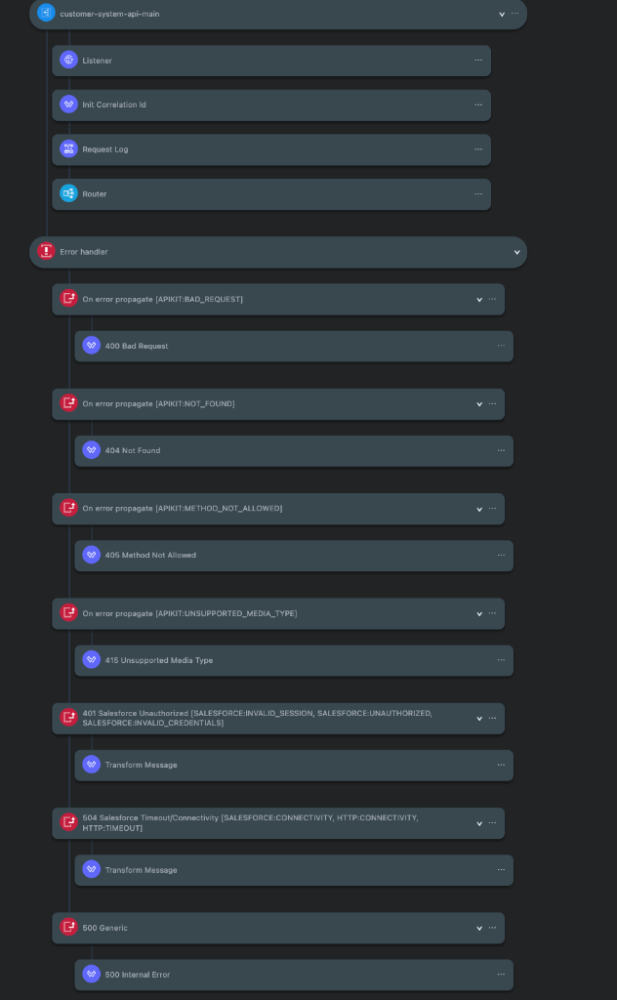
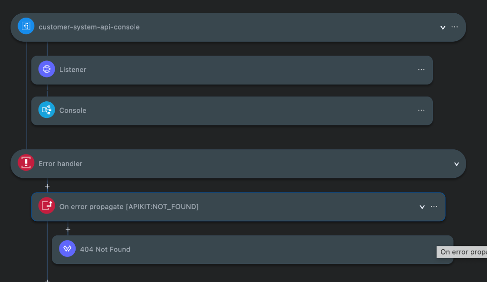
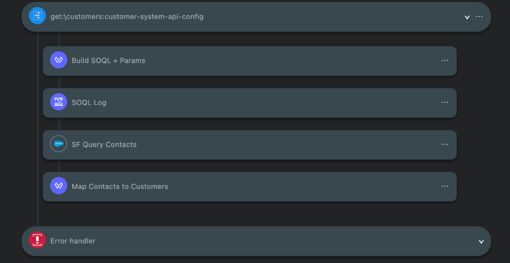
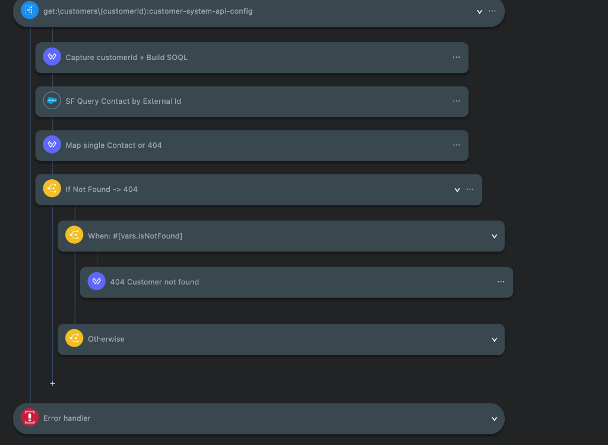
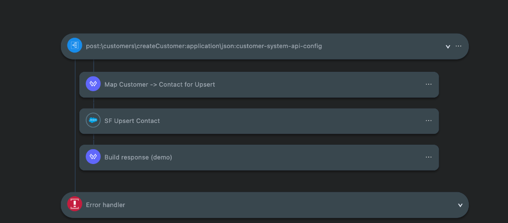

# Customer System API 

Questo repository contiene l'implementazione della **Customer System API**.
L'API funge da livello di *System API* nell'architettura API-led di MuleSoft, esponendo e gestendo l'interazione diretta con il CRM **Salesforce** .


## 📋 Indice
1. [Panoramica dell'Architettura](#-panoramica-dellarchitettura)
2. [Specifiche Tecniche & Endpoint](#-specifiche-tecniche--endpoint)
3. [Dettaglio dei Flussi MuleSoft (Canvas Viewer)](#-dettaglio-dei-flussi-mulesoft-canvas-viewer)
   - [1. customer-system-api-main](#1-customer-system-api-main)
   - [2. customer-system-api-console](#2-customer-system-api-console)
   - [3. get:\customers](#3-getcustomers)
   - [4. get:\customers\(customerId)](#4-getcustomerscustomerid)
   - [5. post:\customers\createCustomer](#5-postcustomerscreatecustomer)
4. [Gestione degli Errori & Tracciamento](#-gestione-degli-errori--tracciamento)
5. [Configurazione](#-configurazione)


## Panoramica dell'Architettura

La **Customer System API** astrae il layer applicativo sottostante (Salesforce CRM) fornendo un'interfaccia REST.

- **Layer**: System API (API-led Connectivity)
- **Runtime**: Mule Runtime 4.x
- **Connettori Principali**: 
  - `HTTP Listener` (interfaccia d'accesso HTTP/REST)
  - `APIKit Router` (routing e validazione semantica/sintattica delle chiamate)
  - `Salesforce Connector` (interrogazioni SOQL e operazioni di Upsert sull'oggetto standard `Contact`)
- **Tracciabilità**: Gestione dell'header `X-Correlation-Id` lungo tutto il ciclo di vita della richiesta e nei log strutturati JSON.


## Specifiche Tecniche & Endpoint

Porta di default: `8081` (configurabile tramite `http.port`).

| Metodo | Path | Descrizione |
|---|---|---|
| `GET` | `/api/customers` | Ricerca ed elenco dei clienti (Contact) con filtri per `email`, `customerId` e paginazione tramite `limit`. |
| `GET` | `/api/customers/{customerId}` | Recupero puntuale del singolo cliente tramite chiave esterna (`ExternalCustomerId__c`). Se non presente, solleva un `404 Not Found`. |
| `POST` | `/api/customers/createCustomer` | Creazione o aggiornamento (*upsert*) del contatto Salesforce tramite External ID (`ExternalCustomerId__c`). |


## Dettaglio dei Flussi MuleSoft (Canvas Viewer)

Di seguito vengono analizzati nel dettaglio i componenti e la sequenza dei flussi visibili nell'interfaccia grafica:


### 1. customer-system-api-main

Questo è il flusso principale d'ingresso dell'applicazione, responsabile del ciclo di vita della richiesta HTTP e dell'instradamento alle logiche di business.



#### Componenti del flusso:
1. **HTTP Listener (`/api/*`)**:
   - Intercetta tutte le chiamate destinate all'API e gestisce le risposte HTTP di successo (`200 default`) ed errore (`500 default`).
   - Propaga gli header HTTP in uscita (`outboundHeaders`).
2. **Init Correlation Id (Transform Message)**:
   - Recupera l'header `X-Correlation-Id` inviato dal client oppure genera un nuovo `uuid()` qualora non presente.
   - Popola la variabile di sessione `correlationId` e imposta l'header `X-Correlation-Id` per la risposta.
3. **Request Log (Logger)**:
   - Scrive un record di log strutturato in formato JSON indicando layer (`sapi`), nome API, `correlationId`, metodo HTTP, percorso invocato e query parameters.
4. **Router (APIKit Router)**:
   - Valida la richiesta rispetto allo schema API e smista l'esecuzione verso il flusso specifico corrispondente all'endpoint e metodo richiesti.
5. **Error Handler (Strategia di Gestione Errori Centralizzata)**:
   - `On error propagate [APIKIT:BAD_REQUEST]`: restituisce HTTP 400 Bad Request formattando un payload JSON standard.
   - `On error propagate [APIKIT:NOT_FOUND]`: restituisce HTTP 404 Resource not found.
   - `On error propagate [APIKIT:METHOD_NOT_ALLOWED]`: restituisce HTTP 405 Method not allowed.
   - `On error propagate [APIKIT:UNSUPPORTED_MEDIA_TYPE]`: restituisce HTTP 415 Unsupported media type.
   - `On error propagate [SALESFORCE:INVALID_SESSION, ...]` (401 Salesforce Unauthorized): mappa problemi di autenticazione Salesforce verso HTTP 502 Bad Gateway.
   - `On error propagate [SALESFORCE:CONNECTIVITY, HTTP:TIMEOUT, ...]` (504 Salesforce Timeout/Connectivity): gestisce timeout o mancata raggiungibilità di Salesforce restituendo HTTP 504 Gateway Timeout.
   - `On error propagate [500 Generic]`: gestisce qualsiasi eccezione imprevista restituendo HTTP 500 Internal Error con `correlationId`.


### 2. customer-system-api-console

Flusso dedicato all'esposizione della console interattiva di documentazione dell'APIKit.



#### Componenti del flusso:
1. **Listener (`/console/*`)**:
   - Riceve le richieste HTTP sul path `/console/*` per accedere all'interfaccia utente grafica dell'API.
2. **Console (APIKit Console)**:
   - Renderizza le specifiche OpenAPI/RAML interattive per permettere il collaudo diretto e la documentazione visuale degli endpoint.
3. **Error Handler**:
   - `On error propagate [APIKIT:NOT_FOUND]`: cattura eventuali richieste verso risorse non definite nella console restituendo un errore JSON 404 (`Resource not found`).

---

### 3. get:\customers

Flusso che gestisce la ricerca e l'estrazione massiva o filtrata dei clienti da Salesforce.



#### Componenti del flusso:
1. **Build SOQL + Params (Transform Message)**:
   - Normalizza il parametro di paginazione `limit` 
   - Sanitizza i filtri opzionali (`email`, `customerId`) .
   - Assegna alla variabile `vars.soql` la query su Salesforce:
     ```sql
     SELECT Id, FirstName, LastName, Email, ExternalCustomerId__c 
     FROM Contact 
     WHERE ... 
     ORDER BY LastName ASC 
     LIMIT ...
     ```
2. **SOQL Log (Logger)**:
   - Traccia nei log applicativi la query SOQL finale generata associata al `correlationId`.
3. **SF Query Contacts (Salesforce Query)**:
   - Esegue la query SOQL tramite il connettore Salesforce sfruttando le credenziali configurate.
4. **Map Contacts to Customers (Transform Message - DataWeave)**:
   - Trasforma la lista di record `Contact` restituiti da Salesforce nel modello canonico JSON della risposta `Customer[]`:
     - `customerId`: mappato da `ExternalCustomerId__c` (o `Id` di Salesforce se assente).
     - `fullName`: concatenazione di `FirstName` e `LastName`.
     - `email`: indirizzo email del contatto.

---

### 4. get:\customers\(customerId)

Flusso per il recupero puntuale di un singolo cliente in base al suo identificativo esterno.



#### Componenti del flusso:
1. **Capture customerId + Build SOQL (Transform Message)**:
   - Estrae il parametro URI `customerId` e costruisce la query SOQL mirata con clausola:
     ```sql
     SELECT Id, FirstName, LastName, Email, ExternalCustomerId__c 
     FROM Contact 
     WHERE ExternalCustomerId__c = '{customerId}' 
     LIMIT 1
     ```
2. **SF Query Contact by External Id (Salesforce Query)**:
   - Invia la richiesta di query puntuale all'istanza Salesforce.
3. **Map single Contact or 404 (Transform Message)**:
   - Ispeziona i record restituiti: se presente il contatto, mappa i campi sul payload canonico (`customerId`, `fullName`, `email`).
   - Se la lista è vuota o null, valorizza la variabile booleana `vars.isNotFound = true`.
4. **If Not Found -> 404 (Choice Router)**:
   - **Branch `When: #[vars.isNotFound]`**:
     - Attiva il componente **404 Customer not found (Transform Message)** che imposta `httpStatus = 404` e genera il messaggio di errore standard:
       ```json
       {
         "correlationId": "...",
         "errorCode": "NOT_FOUND",
         "message": "Customer not found"
       }
       ```
   - **Branch `Otherwise`**:
     - Lascia fluire il payload correttamente mappato al client con codice HTTP 200.


### 5. post:\customers\createCustomer

Flusso deputato alla creazione o aggiornamento  di un cliente (*Upsert*) all'interno di Salesforce.



#### Componenti del flusso:
1. **Map Customer -> Contact for Upsert (Transform Message)**:
   - Riceve il payload JSON in ingresso contenente i dati del cliente (`firstName`, `lastName`, `email`, `customerId`).
   - Salva i dati essenziali in variabili d'appoggio (`externalIdValue`, `customerFullName`, `customerEmail`).
   - Converte i dati in formato Java Map per Salesforce, assegnando il campo identificativo a `ExternalCustomerId__c`.
2. **SF Upsert Contact **:
   - Esegue l'operazione di `Upsert` sull'oggetto Salesforce `Contact`.
   - Utilizza il campo personalizzato `ExternalCustomerId__c` come chiave di riconciliazione (se il record esiste già viene aggiornato, altrimenti ne viene inserito uno nuovo evitando duplicati).
3. **Build response **:
   - Modella la risposta JSON finale verso il chiamante, confermando l'avvenuta sincronizzazione e restituendo l'entità creata/aggiornata con `customerId`, `fullName` ed `email`.


## Gestione degli Errori & Tracciamento

Tutte le risposte di errore prodotte dall'API seguono uno standard uniforme:

```json
{
  "correlationId": "4bf68da8-2964-4e4c-b1b7-7e61bc7a8e52",
  "errorCode": "NOT_FOUND",
  "message": "Customer not found",
  "details": null
}
```

- **Correlation ID**: Ogni richiesta è tracciabile univocamente end-to-end tramite l'header `X-Correlation-Id`.
- **Fault-Tolerance**: Gli errori di connettività verso Salesforce o di credenziali scadute vengono intercettati e rimappati in status code coerenti verso il chiamante (`502` / `504`).

---

## Configurazione 

### Prerequisiti
- **Anypoint Studio** 7.x o estensione **MuleSoft per VS Code**
- **JDK 11** o **JDK 17**
- **Maven** 3.8+
- Account e credenziali di accesso a una Org Salesforce (con Security Token abilitato).

### Proprietà di Configurazione
Definire le credenziali:

```yaml
http:
  port: "8081"

sf:
  username: "tuo-utente@salesforce.com"
  password: "tua-password"
  token: "tuo-security-token"
```


